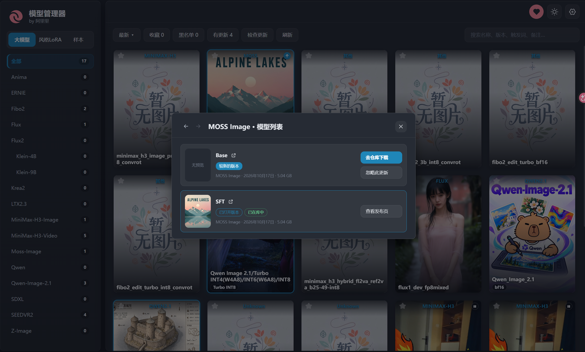
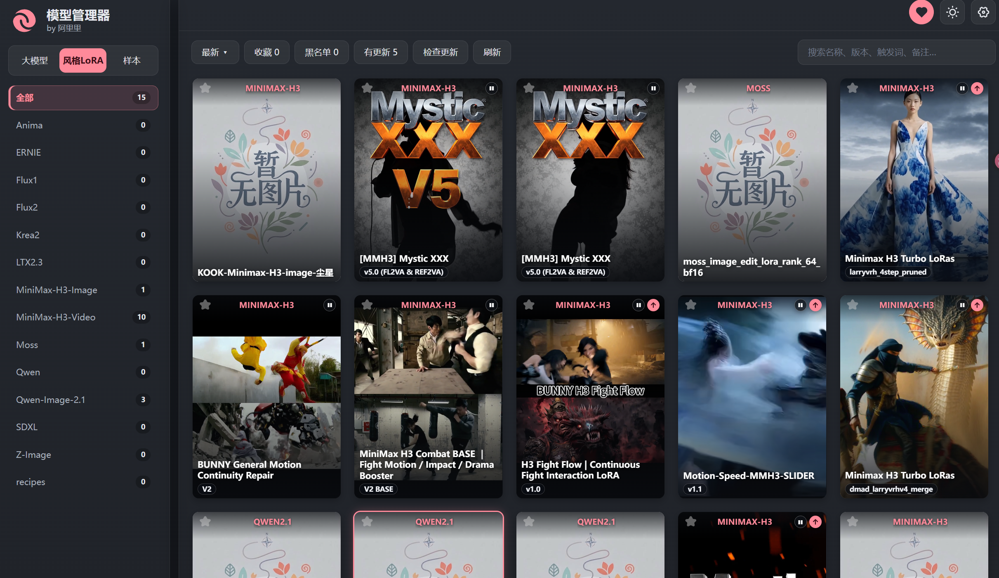
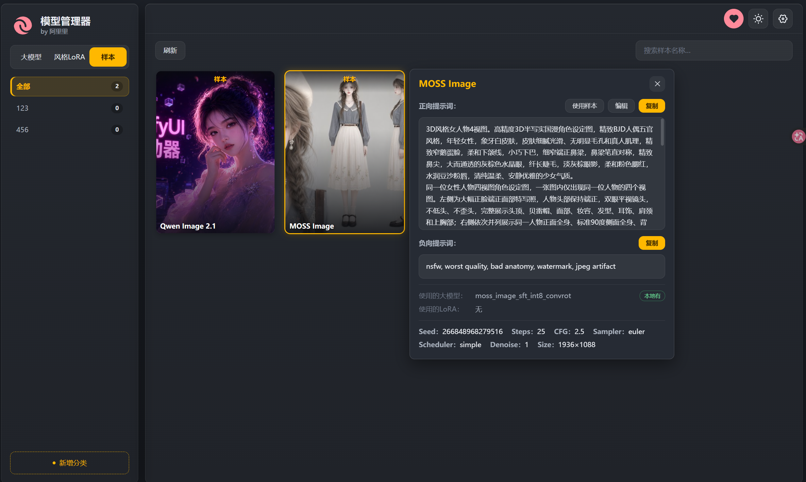
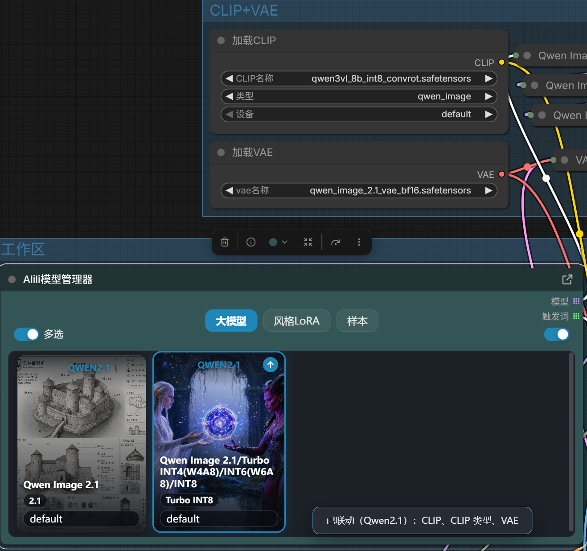

<div align="center">

# 🚀 Alili 模型管理器 (Alili-Manager)

### ComfyUI 大模型 / LoRA 一体化管理后台 · 样本库 · 网页⇄节点联动

[](https://github.com/comfyanonymous/ComfyUI)
[](http://localhost:8188/Manager)
[]()
[]()

**给 ComfyUI 的模型库一个真正的「管理后台」：浏览、封面、元数据、重命名、移动、删除、样本、C 站同步、网页一键发回工作流。**

[📺 B站视频教程](#-b站视频教程) • [✨ 功能亮点](#-功能亮点) • [📸 图片展示](#-图片展示) • [🔧 节点与文件](#-节点与文件-)

---

</div>

## 📖 项目简介

**Alili 模型管理器** 是一套专门为 ComfyUI 打造的「大模型 + LoRA」管理生态。它包含一个无输入口的**模型管理器节点**（只吐出「模型 + 触发词」），以及一个访问地址为 `http://localhost:8188/Manager` 的 **Vue 图形化管理后台**。后台负责模型库的浏览、封面上传、元数据编辑、重命名 / 移动 / 删除、样本收藏，并通过 ComfyUI 自带的 WebSocket 与画布上的节点**实时双向联动**。

作者：**阿里里**。免费向所有人开放使用。

---

## ✨ 功能亮点

### 🧩 大模型 / LoRA 样本（节点端）

- **`Alili模型管理器` 节点**没有输入口，只输出 `模型` 和 `触发词` 两个列表；节点面板**不带搜索框**，筛选靠顶部的家族 / 分类标签，找模型请到后台管理页。
- 在后台勾选**多个大模型**、**多个 LoRA** 后，节点会一次性把它们加载好，并自动把每个 LoRA 的 `trainedWords`（触发词）拼进下游提示词——下游采样器会对每个模型各跑一次。
- 大模型卡片就是「模型加载器」；CLIP / VAE 按 ComfyUI 惯例在**工作流里另外接**，与本节点无关。
- 选择状态由前端写入隐藏的 `state`（JSON）字段，格式示例：
  ```json
  {"multi":{"lora":false,"model":false},
   "models":[{"key":"diffusion_models","name":"Qwen-Image/x.safetensors","dtype":"default"}],
   "loras":[{"name":"Flux2/y.safetensors","w":1.0}]}
  ```

### 🗂️ 后端管理页面（Web Manager）

- 访问 `http://localhost:8188/Manager` 打开完整后台：**文件夹目录树**、卡片网格、按基础模型家族筛选、收藏 / 拉黑。
- 管理动作全部「配套文件一起处理」：**重命名 / 移动 / 删除** 时，模型本体连同封面图、视频预览、`.metadata.json` 及其 `.bak` 备份会一起处理，任何一步失败整体回滚，绝不留半截文件。
- **打开文件位置（reveal）**：一键在资源管理器里选中该模型文件（Windows / macOS / Linux 均支持）。
- **统一的弹窗表单**：卡片详情与系统设置都改用「标签 | 内容 | 操作」三列等宽网格，控件高度一致，整页只有一个滚动条，不再有错位的高低灰盒。
- **卡片 / 分类树拖拽动效**：卡片悬停上浮 + 强调色描边、拖起时加重阴影；拖起卡片时左侧可落点文件夹一起亮起，命中项脉冲高亮并显示插入指示线，换位走 FLIP 平滑归位（借鉴 Alili 资产管理器）。

### 🖼️ 大模型 LORA 样本库（Samples）

- 把「用到了哪些模型 / LoRA、提示词、采样参数」**保存成样本**，并自动抓取最近一次成功运行的参数（提示词 / 采样参数 / 模型 / LoRA），历史为空时用画布兜底。
- 样本支持**分类管理**（每个分类 = `data` 下的真实文件夹），可新建 / 重命名 / 删除 / 拖拽排序 / 跨分类移动。
- 每个样本带封面缩略图；样本库整体就是 `data/` 文件夹，**复制整个 `data` 即可备份 / 搬家**，把别人的分类文件夹拷进来也会自动识别为一个分类。
- 兼容旧版存储结构，首次启动会自动迁移（`data/samples` → `data/Default` 与各分类文件夹）。

### 🔗 网页⇄节点联动

- 基于 ComfyUI 自带 WebSocket 广播，无需额外进程：
  - **「发送到工作流」**：后台把选中的模型 / LoRA 推回画布上的节点。
  - **选择高亮同步**：节点里的选择变化会回报给网页，网页同步高亮。
  - **改名即同步引用**：模型改名后，自定义排序、样本里引用的旧名字会自动改掉，已保存工作流里的节点也会同步。

### 🌐 CivitAI（C 站）集成

- **拉取数据（刷新）**：按文件 SHA256 哈希对上 CivitAI，自动补全标题 / 版本 / 基础模型 / 触发词 / 封面 / 作者，并保留你手动改过的内容（标题、备注、自定义封面等会提示确认）。
- **检查更新**：版本号比本地大 + 基础模型相同 + 允许下载的版本才算「有更新」；支持**忽略此更新**、忽略早期访问（Early Access）。
- **只拉触发词**：单独接口，只把触发词填回输入框，不写盘，等你确认。
- **封面 / 视频预览**：示例图逐张尝试（浏览器 UA、`civitai.com ⇄ civitai.red` 域名回退，PIL 打不开的 AVIF / WEBP 原样保存）；C 站视频模型的 `type="video"` mp4 会存成模型同名 `.preview.mp4`，卡片静音循环播放、右上角可暂停。只有视频没有静态图时自动抽第一帧当封面。
- **禁止播放**：系统设置齿轮里打开后，卡片一律只显示静态封面，不再加载视频。
- 网络层自动处理：代理、`civitai.com ⇄ civitai.red` 自动切换、证书库回退、429 / 5xx 限流重试。

### 📝 文件名以及元数据 🧭

- 每个模型都有**同名的 `.metadata.json`** 配套：记录 `model_name` / `base_model` / `notes` / `trainedWords` / 收藏 / 拉黑 / CivitAI 版本列表 / 作者 / 检查时间等。
- 模型家族识别：**只认 `clip_map.json` 一张表**。键名既是卡片角标，也是联动的唯一配置入口——键名（或历史匹配词）能对上模型的 `base_model` / 文件夹名 / 文件名（去掉符号后包含即可）就命中，长词优先（如 `Flux2` 先于 `Flux`）。这张表在后台齿轮里直接增删改，不用打开代码。
- 封面支持多种命名 / 格式（含参考插件 `.preview.xxx` 规则）：`.jpeg/.jpg/.png/.webp/.gif/.avif` 以及 `.preview.*`；也可从工作流输出图直接取封面。
- 自定义拖拽排序存于 `data/order.json`。

### ⚙️ 设置（后台右上角的齿轮）

- **CivitAI**：`civitai_base`（默认 `https://civitai.red`）、`proxy`、`api_key`、`hide_early_access`，存于 `data/settings.json`。
- **卡片预览**：`disable_video` —— 禁止播放视频，开启后卡片只显示静态封面。
- **模型家族识别表**：`clip_map.json` 直接在齿轮里可视化维护。粘贴名字 →「+ 新增条目」即可；每条可编辑 `clip / clip2 / type / vae / vae2`。**键名可以随便改**：保存时旧名字会自动写进该条目的 `aliases`（历史匹配词），角标立刻变成新名字、联动仍认原来的文件夹 / 文件名，**不用再去任何下拉里重选一次**。保存后立即生效（节点端每次现取，不用重启 ComfyUI）。

> 只维护这一张表，改完点「保存全部」即可。`base_models.json` 已彻底移除，卡片弹窗里的「基础模型」改为只读显示，只作参考。

### ☕ 支持作者

主题切换按钮左边是粉色头像按钮，点开是打赏卡片（收款二维码），底部「作者仓库」直达 https://github.com/xtooou/Alili-Manager 。

---

## 📸 图片展示

> 💡 **把你自己准备的截图放进本目录下的 `images/` 文件夹，并替换下面的文件名即可自动生效**（已预留 `images/Generic.jpg` 与 `images/svg/` 图标位）。

| 后台管理页 | 模型卡片 / 元数据 |
| :---: | :---: |
|  |  |
| 模型库浏览与筛选 | 触发词 / 基础模型 / 备注编辑 |

| 样本库 | 网页⇄节点联动 |
| :---: | :---: |
|  |  |
| 分类管理与封面 | 发送到工作流 / 高亮同步 |

---

## 📺 B站视频教程

> 完整视频教程请关注作者 B 站空间，分集上线后会在此补充对应链接：

👉 **B 站教程空间**：https://space.bilibili.com/67359822

---

## 📦 安装

1. 把整个 `Alili-Manager` 文件夹放进 ComfyUI 的 `custom_nodes/` 目录：
   ```
   ComfyUI/custom_nodes/Alili-Manager/
   ```
2. 重启 ComfyUI。
3. 浏览器访问 `http://localhost:8188/Manager` 打开管理后台。
4. 在画布右键 → `Alili` 分类下找到 **Alili模型管理器** 节点。

> 节点脚本只放在 `ext/`（ComfyUI 会自动加载 `WEB_DIRECTORY` 下的 `.js`）；后台页面资源放在 `web/`，由 `server.py` 通过 `/alili/web/...` 单独提供。

---

## 🔧 节点与文件

### 核心节点

| 节点名 | 类别 | 说明 |
| :--- | :--- | :--- |
| **Alili模型管理器** | `Alili` | 无输入口；输出「模型 + 触发词」列表，支持多模型 / 多 LoRA 与触发词自动注入 |

### 文件结构 🧭

```
Alili-Manager/
├── __init__.py          # 入口：导入 nodes / server，注册 WEB_DIRECTORY="./ext"
├── nodes.py             # AliliModelManager 节点（输出 模型 + 触发词，读 .metadata.json）
├── server.py            # 后台路由主体：列表/树/封面/元数据/重命名/移动/删除/样本/联动/设置
├── civitai.py           # CivitAI 拉取数据、刷新触发词、检查更新（哈希对版、限流重试）
├── capture.py           # 运行参数解析（提示词 / 采样参数 / 模型 / LoRA）
├── clip_map.json        # 模型家族识别映射（后台齿轮里可视化维护）
├── ext/
│   └── node.js          # 节点前端脚本（ComfyUI 自动加载）
├── web/                 # 后台页面资源（由 /alili/web/ 提供）
│   ├── manager.html
│   ├── manager.js / core.js / components.js / civitai.js
│   ├── alili.css
│   └── vue.esm-browser.prod.js
└── images/              # 图标（logo/edit/moon/settings/sun/user.svg）+ Generic.jpg + 打赏二维码 sponsor-qr.png
```

---

## ❓ 常见问题

**Q：后台打不开？**
> 确认 ComfyUI 已启动，访问 `http://localhost:8188/Manager`（端口按你的启动参数，默认 8188）。

**Q：改名 / 移动后封面或元数据丢了？**
> 不会。重命名 / 移动会把模型本体连同封面图、视频预览、`.metadata.json` 及其 `.bak` 一起处理，任一步失败整体回滚。

**Q：CivitAI 拉取失败 / 限流？**
> 后台设置里可填 `proxy`、`api_key`，并会自动在 `civitai.com ⇄ civitai.red` 间切换，遇到 429 / 5xx 会自动重试；也可手动设置 `civitai_base`。

**Q：卡片显示「暂无图片」？**
> 右键「刷新 CivitAI 数据」。现在会逐张尝试示例图，也会拉取 C 站的视频预览并在卡片播放；只有视频时会自动抽第一帧当静态封面。还是没有的话可以手动「上传封面」。

**Q：新出的模型家族要怎么加到识别表？**
> 后台右上角齿轮 →「模型家族识别表」，把名字粘进输入框点「+ 新增条目」，填上 CLIP / VAE 再「保存全部」即可。键名只要能对上模型的 `base_model` / 文件夹名 / 文件名就行（去掉符号后包含即可，大小写无所谓）。

**Q：改了识别表的键名，联动会断吗？**
> 不会。保存时旧键名会自动存成该条目的 `aliases`（历史匹配词），卡片角标立刻变成新名字，CLIP / VAE 联动还是按这一条配置走，不用再去别处重选。设置面板里能看到每条的历史匹配词。
>
> 匹配依据是模型的 `base_model`（同步 C 站时写入）/ 文件夹名 / 文件名三者任一，所以文件夹随便改名也不影响，只要文件名里还有那个词。CLIP / VAE 文件按纯文件名对齐到 ComfyUI 的下拉选项，放在 `models/clip`、`models/vae` 的子目录里也能找到。

**Q：样本数据怎么备份？**
> 直接复制插件目录里的 `data/` 文件夹即可（分类 = 其中的真实子文件夹）。

---

## 📄 许可

本项目**免费向所有人开放**使用。作者：**阿里里**。

⭐ 如果这个项目帮到了你，欢迎 Star 与分享！
